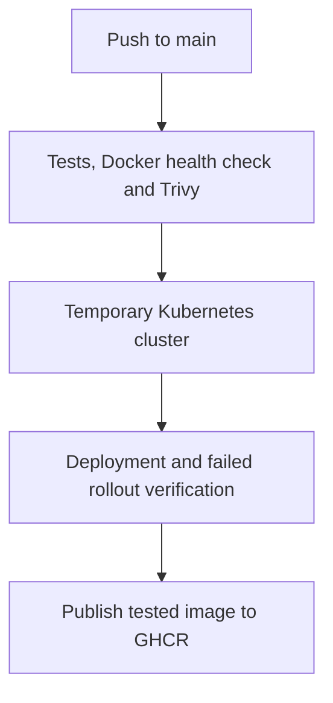

# Order Management System

A Java 21 / Spring Boot order management API with a working DevOps pipeline: PostgreSQL integration tests, Docker health checks, Trivy vulnerability scanning, automated Kubernetes deployment and rollback verification, and versioned image publishing to GitHub Container Registry.

It manages products, customers, stock, and the full order lifecycle.

> **Local learning project:** there is no authentication or authorization. Do not expose this application directly to the internet or use real customer data.

## DevOps pipeline

Workflow: [`.github/workflows/ci.yml`](.github/workflows/ci.yml). Check runs and downloadable artifacts in [GitHub Actions](https://github.com/Techy-Raihan/first-ci-cd-project/actions).



| Job | Verification |
| --- | --- |
| `build-and-test` | Java 21 build, ordinary tests, real PostgreSQL 17 integration tests, Docker Compose startup, health endpoint, and vulnerability gate |
| `kubernetes-test` | Loads the scanned image into kind, deploys PostgreSQL and the API, checks health, introduces a missing image, verifies a healthy pod remains available, then rolls back |
| `publish-image` | Publishes the same tested image after both preceding jobs pass, using the workflow's `GITHUB_TOKEN` |

Pull requests run the build/test/security job. Kubernetes verification and publishing run on pushes to `main`. A manual workflow dispatch runs the build/test/security job only. The temporary CI cluster is deleted after the run and does not update the laptop cluster.

Published image tags:

```text
ghcr.io/techy-raihan/first-ci-cd-project:latest
ghcr.io/techy-raihan/first-ci-cd-project:sha-<full-commit-sha>
```

Use a commit tag to reproduce a particular build; `latest` changes after successful main-branch pushes. Private packages require Docker authentication before pulling.

Artifacts include test reports, the executable JAR, the full Trivy JSON report, Kubernetes diagnostics, and a short-lived image archive. Reports are retained for seven days and the image archive for one day.

## Run with Docker Compose

Start Docker Desktop in Linux-container mode. Run these commands from the repository directory, with Java 21 available:

```powershell
$env:COMPOSE_DB_PASSWORD = 'replace_with_a_local_demo_password'
.\mvnw.cmd clean verify
docker compose up --build -d --wait --wait-timeout 180
docker compose ps
Invoke-RestMethod http://localhost:8080/actuator/health
```

The Dockerfile packages an already-built JAR, so run Maven before rebuilding the image after Java changes. The application runs as a non-root user with a 384 MB maximum Java heap. Compose limits application memory to 768 MB and PostgreSQL to 256 MB.

Open [Swagger UI](http://localhost:8080/swagger-ui.html). PostgreSQL is reachable by the application on the Compose network; its database port is not published to Windows.

Stop the stack using the same PowerShell session:

```powershell
docker compose down
```

In a new terminal, set `COMPOSE_DB_PASSWORD` again before using Compose, including `down`. The named volume preserves database data when containers stop. Reuse the original password for an existing database volume; changing the environment variable does not change its database password.

## Run on local Kubernetes with kind

Prerequisites: running Docker Desktop, `kind`, and `kubectl`. This setup uses one kind node and one application replica to fit a small learning environment. Stop Compose first to free resources and port 8080.

```powershell
$env:COMPOSE_DB_PASSWORD = 'replace_with_a_local_demo_password'
docker compose down
kind create cluster --name order-dev --image kindest/node:v1.37.0 --wait 180s
kubectl --context kind-order-dev get nodes

docker pull ghcr.io/techy-raihan/first-ci-cd-project:latest
docker tag ghcr.io/techy-raihan/first-ci-cd-project:latest order-management:k8s-v1
kind load docker-image order-management:k8s-v1 --name order-dev

kubectl --context kind-order-dev create namespace order-demo
kubectl --context kind-order-dev -n order-demo create secret generic database-password --from-literal=password=replace_with_a_local_demo_password
kubectl --context kind-order-dev apply -f .\k8s\local.yml
kubectl --context kind-order-dev -n order-demo rollout status statefulset/postgres --timeout=180s
kubectl --context kind-order-dev -n order-demo rollout status deployment/order-app --timeout=240s
kubectl --context kind-order-dev -n order-demo get pods,pvc
```

Cluster, namespace, and secret creation commands are for the first setup; skip them when those resources already exist. Keep the secret password consistent with any existing PostgreSQL data. The local image has `imagePullPolicy: Never`, so loading it into kind is required.

[`k8s/local.yml`](k8s/local.yml) defines the application Deployment and Service, a PostgreSQL StatefulSet and headless Service, and a 1 GiB persistent volume claim. The application uses startup, readiness, and liveness probes, resource limits, a non-root security context, and a database password supplied through a Kubernetes Secret. Secret values are created separately from the manifest.

Keep port forwarding running in one PowerShell window:

```powershell
kubectl --context kind-order-dev -n order-demo port-forward service/order-app 8080:8080
```

In a second window:

```powershell
Invoke-RestMethod http://localhost:8080/actuator/health
```

Expected health status: `UP`. Port forwarding stays in the foreground until Ctrl+C. If port 8080 is occupied, stop the existing application/forwarding process or forward `8081:8080` and visit `http://localhost:8081`.

## Demonstrate recovery and rollback

To demonstrate pod replacement:

```powershell
kubectl --context kind-order-dev -n order-demo delete pod -l app=order-app
kubectl --context kind-order-dev -n order-demo get pods -w
```

Wait for the replacement application pod to become `1/1 Running`, then press Ctrl+C to stop watching. A single-replica pod deletion can temporarily interrupt requests; restart port forwarding if its selected pod was deleted.

To demonstrate a failed rollout:

```powershell
kubectl --context kind-order-dev -n order-demo set image deployment/order-app app=order-management:missing-demo
kubectl --context kind-order-dev -n order-demo get pods
```

The new pod reports `ErrImageNeverPull`. The existing healthy pod stays available because the rolling update uses `maxUnavailable: 0` and `maxSurge: 1`.

Restore the working revision and reconcile it with the manifest:

```powershell
kubectl --context kind-order-dev -n order-demo rollout undo deployment/order-app
kubectl --context kind-order-dev -n order-demo rollout status deployment/order-app --timeout=180s
kubectl --context kind-order-dev apply -f .\k8s\local.yml
Invoke-RestMethod http://localhost:8080/actuator/health
```

The CI Kubernetes job automates the missing-image failure and rollback checks. Pod deletion/replacement was also demonstrated locally.

## Security scan policy

Trivy scans the built image. The gate blocks fixable HIGH and CRITICAL findings except the reviewed entries in [`.trivyignore.yaml`](.trivyignore.yaml). Unfixed findings do not fail this gate. The full JSON report is generated without this exception policy so findings remain visible; a green pipeline does not mean zero vulnerabilities.

| Exception | Current application scope | Expiry |
| --- | --- | --- |
| [CVE-2026-47884](https://spring.io/security/cve-2026-47884/) | REST JSON controllers; no XsltView or wildcard view-rendering handler | 2026-11-10 |
| [CVE-2026-47890](https://spring.io/security/cve-2026-47890/) | No Server-Sent Events view-fragment rendering | 2026-11-10 |

Reassess these exceptions before expiry or immediately if rendering or SSE features are added. Dependency versions and the base-image packages have been updated to address other findings observed during setup.

## Verified project milestones

- Ordinary and PostgreSQL integration tests passed locally on Windows with Java 21.
- Docker Compose application and database health checks passed.
- Local kind deployment reached ready status and `/actuator/health` returned `UP`.
- Pod replacement and failed-image rollback were demonstrated locally.
- All three GitHub Actions jobs passed for commit `d438bed`: build/security, Kubernetes verification, and GHCR publishing.

## Resume example

Built a GitHub Actions pipeline for a Java Spring Boot and PostgreSQL application with integration tests, Docker health checks, Trivy vulnerability scanning, automated Kubernetes deployment and rollback verification, and commit-versioned image publishing to GHCR.

## Technology versions

- Java 21
- Spring Boot 3.5.16
- Maven 3.9.11 through Maven Wrapper
- PostgreSQL 14 or newer (17 is a good local choice)
- Flyway (version managed by Spring Boot)
- springdoc-openapi 2.8.17
- JUnit 5, Mockito, and AssertJ (versions managed by Spring Boot)

Spring Boot 3.5.16 supports Java 17 through 25, so Java 21 is supported. springdoc 2.8.x is the matching line for Spring Boot 3.5.x.

## Business rules

- SKUs and customer email addresses are unique ignoring letter case. They are stored as uppercase SKUs and lowercase emails.
- Prices must be positive, stock cannot be negative, and all money uses `BigDecimal` with two database decimal places.
- Products are deactivated rather than deleted, so historical order references remain valid.
- Orders require one or more different products. Repeated product IDs are rejected; the client must combine the quantities.
- The server reads current prices, stores SKU/name/price snapshots, calculates line totals and the order total, then deducts stock in one transaction.
- Product rows are locked with PostgreSQL pessimistic write locks in ID order. Concurrent orders cannot spend the same stock.
- Lifecycle: `CREATED -> CONFIRMED -> SHIPPED -> DELIVERED`.
- Only `CREATED` or `CONFIRMED` orders can be cancelled. Cancellation locks the order and products, restores stock once, and changes the status to `CANCELLED` in one transaction.

## Project structure

```text
src/main/java/com/example/orders/
  product/        product entity, repository, DTOs, service, controller, mapper
  customer/       customer feature
  order/          order and order-item feature, locking and lifecycle logic
  shared/         errors, pagination, timestamps, OpenAPI, dev seed data
src/main/resources/
  db/migration/   Flyway SQL migrations
  application*.yml
src/test/
  ...Test.java    fast unit and MVC tests
  ...IT.java      real PostgreSQL integration/concurrency tests
requests/
  order-management.http
```

## Prerequisites on Windows

Open PowerShell as your normal user. Install a Java 21 JDK if needed:

```powershell
winget install EclipseAdoptium.Temurin.21.JDK
java -version
```

If `java` is not found after installation, open a new PowerShell window. Set `JAVA_HOME` to the installed JDK folder if the wrapper asks for it. For example (adjust the folder to the installed version):

```powershell
$env:JAVA_HOME = 'C:\Program Files\Eclipse Adoptium\jdk-21.0.x-hotspot'
$env:Path = "$env:JAVA_HOME\bin;$env:Path"
```

Install PostgreSQL using the official Windows installer from <https://www.postgresql.org/download/windows/>. During setup, keep port `5432`, install Command Line Tools, and remember the `postgres` administrator password. You can also find an available winget package first:

```powershell
winget search PostgreSQL.PostgreSQL
```

After installation, open a new PowerShell window and add the actual PostgreSQL `bin` folder to this session if `psql` is not found:

```powershell
$env:Path += ';C:\Program Files\PostgreSQL\17\bin'
psql --version
```

## Create the databases and user

Connect as the administrator. `psql` prompts for the password selected during installation:

```powershell
psql -U postgres -h localhost
```

Run these SQL statements inside `psql`:

```sql
CREATE USER order_app WITH PASSWORD 'choose_a_strong_local_password';
CREATE DATABASE order_management OWNER order_app;
CREATE DATABASE order_management_test OWNER order_app;
\q
```

The separate `_test` database is important. Integration tests refuse to clean any database whose name does not end in `_test`. Flyway clean is also disabled.

## Environment variables

`.env.example` is documentation only. Spring Boot does **not** automatically load `.env` files.

Set variables in the current PowerShell window before running the app:

```powershell
$env:ORDER_DB_URL = 'jdbc:postgresql://localhost:5432/order_management'
$env:ORDER_DB_USERNAME = 'order_app'
$env:ORDER_DB_PASSWORD = 'choose_a_strong_local_password'
$env:SPRING_PROFILES_ACTIVE = 'dev'
```

These values last only for that PowerShell session. To save them for future terminals, use `setx` and then open a new terminal:

```powershell
setx ORDER_DB_URL 'jdbc:postgresql://localhost:5432/order_management'
setx ORDER_DB_USERNAME 'order_app'
setx ORDER_DB_PASSWORD 'choose_a_strong_local_password'
setx SPRING_PROFILES_ACTIVE 'dev'
```

The `dev` profile runs an idempotent sample-data seeder. It checks unique SKU/email values before inserting and never runs without the `dev` profile. Omit the profile if you want an empty database.

## Run, test, and package

From this project directory:

```powershell
cd D:\order-management-system
.\mvnw.cmd test
.\mvnw.cmd clean package
.\mvnw.cmd spring-boot:run
```

The first wrapper command downloads Maven 3.9.11 and dependencies. Normal unit tests and packaging do not need PostgreSQL because the real-database integration tests are excluded unless the profile below is selected.

When the application starts, Flyway applies the schema and Hibernate validates that its entity mapping matches it.

- Swagger UI: <http://localhost:8080/swagger-ui.html>
- OpenAPI JSON: <http://localhost:8080/v3/api-docs>
- Health check: <http://localhost:8080/actuator/health>

Only the basic health endpoint is exposed, without sensitive component details.

## Real PostgreSQL integration tests

Set dedicated test variables and activate the Maven profile:

```powershell
$env:ORDER_TEST_DB_URL = 'jdbc:postgresql://localhost:5432/order_management_test'
$env:ORDER_TEST_DB_USERNAME = 'order_app'
$env:ORDER_TEST_DB_PASSWORD = 'choose_a_strong_local_password'
.\mvnw.cmd verify -Ppostgres-it
```

This profile tests Flyway startup, full transaction rollback, concurrent stock deduction, and concurrent cancellation. It deletes test rows between tests only after verifying the active database name ends with `_test`.

## Complete example flow

The examples below use PowerShell and assume an empty database. Keep the returned IDs instead of assuming they are `1`.

```powershell
$base = 'http://localhost:8080/api/v1'

$customer = Invoke-RestMethod -Method Post -Uri "$base/customers" -ContentType 'application/json' -Body (@{
  name = 'Ravi Kumar'; email = 'ravi@example.com'; phone = '+91 98765 43210'
  deliveryAddress = '12 Park Road, Pune, Maharashtra 411001'
} | ConvertTo-Json)

$keyboard = Invoke-RestMethod -Method Post -Uri "$base/products" -ContentType 'application/json' -Body (@{
  sku = 'KEY-100'; name = 'Mechanical Keyboard'; description = 'Quiet switches'
  price = 4999.00; stockQuantity = 10
} | ConvertTo-Json)

$mouse = Invoke-RestMethod -Method Post -Uri "$base/products" -ContentType 'application/json' -Body (@{
  sku = 'MOUSE-100'; name = 'Wireless Mouse'; description = 'USB-C charging'
  price = 1999.00; stockQuantity = 20
} | ConvertTo-Json)

$orderBody = @{
  customerId = $customer.id
  items = @(
    @{ productId = $keyboard.id; quantity = 1 },
    @{ productId = $mouse.id; quantity = 2 }
  )
} | ConvertTo-Json -Depth 4
$order = Invoke-RestMethod -Method Post -Uri "$base/orders" -ContentType 'application/json' -Body $orderBody

Invoke-RestMethod -Method Post -Uri "$base/orders/$($order.id)/confirm"
Invoke-RestMethod -Method Post -Uri "$base/orders/$($order.id)/ship"
Invoke-RestMethod -Method Post -Uri "$base/orders/$($order.id)/deliver"
Invoke-RestMethod -Method Get -Uri "$base/orders/$($order.id)"
```

The total is calculated from stored product prices. Price, SKU, and name in the returned order items are historical snapshots.

## Cancellation and stock restoration example

Create a second order with one keyboard, record its stock after creation, cancel it, and read the product again:

```powershell
$cancelBody = @{
  customerId = $customer.id
  items = @(@{ productId = $keyboard.id; quantity = 1 })
} | ConvertTo-Json -Depth 4
$cancelOrder = Invoke-RestMethod -Method Post -Uri "$base/orders" -ContentType 'application/json' -Body $cancelBody
$afterOrder = Invoke-RestMethod -Uri "$base/products/$($keyboard.id)"
$cancelled = Invoke-RestMethod -Method Post -Uri "$base/orders/$($cancelOrder.id)/cancel"
$afterCancel = Invoke-RestMethod -Uri "$base/products/$($keyboard.id)"
$afterOrder.stockQuantity
$afterCancel.stockQuantity
```

The second value should be exactly one greater. Repeating the cancellation returns `409 INVALID_ORDER_TRANSITION` and does not restore stock again.

## API summary

All endpoints start with `/api/v1`:

- Products: `POST /products`, `GET /products`, `GET /products/{id}`, `PUT /products/{id}`, `DELETE /products/{id}` (deactivate)
- Customers: `POST /customers`, `GET /customers`, `GET /customers/{id}`, `PUT /customers/{id}`
- Orders: `POST /orders`, `GET /orders`, `GET /orders/{id}`
- Lifecycle: `POST /orders/{id}/confirm`, `/ship`, `/deliver`, `/cancel`

Lists accept `page`, `size` (1-100), `sort`, and `direction` (`asc` or `desc`). Products also accept `search`; orders accept `customerId` and `status`. Each endpoint rejects sort fields outside its documented allow-list.

## Manual API requests

Open `requests/order-management.http` in IntelliJ IDEA or a VS Code REST Client extension. Run requests in order and copy returned IDs into the variables at the top when your database does not use IDs `1`, `2`, and `3`.

## Troubleshooting

- **`JAVA_HOME is not set`:** set it to the JDK 21 folder, not its `bin` folder, then verify `& "$env:JAVA_HOME\bin\java.exe" -version`.
- **`psql` is not recognized:** add `C:\Program Files\PostgreSQL\<version>\bin` to `Path`, or run `psql.exe` by full path.
- **Connection refused:** open Windows Services, verify the `postgresql-x64-*` service is running, and confirm port `5432`.
- **Password authentication failed:** make the environment-variable password match the `order_app` database user. Avoid special PowerShell interpolation by using single quotes.
- **Database does not exist:** create both databases using the SQL above and confirm with `psql -U order_app -h localhost -d order_management`.
- **Flyway validation error:** do not hand-edit tables. Check migration history with `SELECT * FROM flyway_schema_history ORDER BY installed_rank;`.
- **Port 8080 already in use:** run `$env:SERVER_PORT = '8081'` before starting.
- **Wrapper download blocked:** configure your network/proxy or install Maven 3.9.x temporarily and run `mvn test`. Do not commit downloaded credentials or proxy passwords.
- **Dev samples do not appear:** confirm `$env:SPRING_PROFILES_ACTIVE` is `dev`. Existing sample records are not overwritten.

## Known limitations and future work

- No authentication, authorization, audit user, payment processing, frontend, or outbound notifications.
- Customer contact and address data are stored as plain application data; use fake local data only.
- No idempotency key for order creation. A client retry can create a separate order if the first response is lost.
- Product updates set absolute stock. A later inventory feature should record stock movements instead.
- No order search by date range, reporting, returns, partial fulfilment, or soft deletion of customers.
- The API returns Spring Data's page JSON shape. A stable custom page DTO can be added if this becomes a public contract.
- Kubernetes deployment is verified in a temporary CI cluster. Deployment to the local laptop remains manual; no persistent cloud deployment is configured.
- PostgreSQL runs as a single instance. Its volume provides persistence within the cluster, not database backups or high availability.

